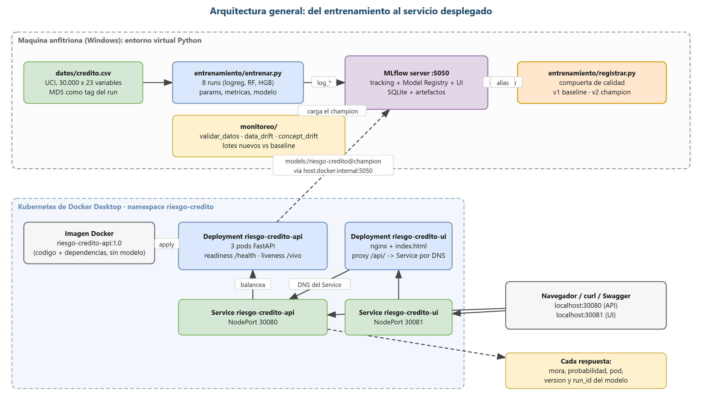

# Documento de arquitectura

Proyecto `riesgo-credito-mlops` · Módulo ML-Ops y Puesta en Producción · Omar Terceros Vallejos

## 1. Problema y modelo

Clasificación binaria: ¿el cliente de tarjeta de crédito entrará en mora el mes siguiente?
Dataset público UCI *Default of Credit Card Clients* (30.000 filas, 23 variables de entrada,
22,1 % de mora), descargado de Kaggle (`uciml/default-of-credit-card-clients-dataset`) y
convertido al esquema del proyecto por `datos/descargar.py`. La métrica principal es **roc_auc**: la clase positiva es minoritaria y la
decisión de negocio (aprobar, pedir garantía, rechazar) se toma con la probabilidad y un umbral
ajustable, no con la etiqueta dura; AUC no depende del umbral y permite comparar modelos entre sí.

## 2. Vista general



Cómo leerlo: la zona superior es la máquina anfitriona (datos, entrenamiento, el servidor de
MLflow con tracking + registry + UI, y el monitoreo); la inferior es el clúster de Kubernetes. Las
flechas sólidas son flujo de datos o de peticiones; las punteadas son lecturas o escrituras del
Model Registry. `entrenar.py` envía los runs al servidor; `registrar.py` lee el mejor run, aplica
la compuerta de calidad y escribe el alias `champion`. La imagen Docker no contiene el modelo:
cada pod del Deployment lo carga por alias desde `host.docker.internal:5050` al arrancar, y hasta
entonces no recibe tráfico. El Service de la API (NodePort 30080) balancea entre los pods Ready; la
interfaz (nginx) hace proxy de `/api/` a ese Service por DNS interno y se expone en el NodePort
30081. Cada respuesta trae el pod que atendió y la versión y run_id del modelo: la trazabilidad
cruza las dos zonas. El mismo diagrama, en texto:

```
             entrena / compara / registra                      consume por alias
  ┌──────────────┐    HTTP :5050    ┌────────────────────┐   models:/riesgo-credito@champion
  │ entrenar.py  │ ───────────────► │  MLflow server      │ ◄──────────────────────────────┐
  │ registrar.py │                  │  tracking + registry│  http://host.docker.internal:5050
  └──────────────┘                  │  + UI (SQLite)      │                                │
                                    └────────────────────┘                                │
                                                                                          │
  Kubernetes (Docker Desktop) · namespace riesgo-credito                                  │
  ┌───────────────────────────────────────────────────────────────────────────────────────┼──┐
  │  Service riesgo-credito-ui (NodePort 30081)      Service riesgo-credito-api (NodePort 30080)│
  │         │                                                 │  balancea entre 3 pods        │
  │  ┌──────▼──────┐   /api/ -> DNS del Service   ┌───────────▼───────────┐                   │
  │  │ nginx + UI  │ ────────────────────────────►│ Deployment api x3     │ ──────────────────┘
  │  │ (ConfigMap) │                              │ imagen riesgo-credito-api:1.0 (FastAPI)   │
  │  └─────────────┘                              │ POD_NAME, probes, requests/limits         │
  │                                               └───────────────────────┘                   │
  └──────────────────────────────────────────────────────────────────────────────────────────┘
        ▲ navegador: http://localhost:30081            ▲ curl / Swagger: http://localhost:30080
```

Monitoreo (fuera del camino de la petición): `monitoreo/data_drift.py` compara cada lote nuevo
con el baseline de entrenamiento; `monitoreo/concept_drift.py` evalúa el champion lote a lote
cuando llegan las etiquetas y aplica el criterio de reentrenamiento.

## 3. Modelo desplegado: trazabilidad versión ↔ run

| | Valor |
|---|---|
| Nombre en el Model Registry | `riesgo-credito` |
| Alias que consume el servicio | `champion` (`models:/riesgo-credito@champion`) |
| Versión que corresponde al alias | **2** |
| Run que la produjo | `f8dfebea1f6846ae8d62e0aca7711214` (`hgb_lr0.1_400it_prof4`, experimento `riesgo-credito`) |
| roc_auc en test (6.000 clientes) | 0.7797 |
| Datos de entrenamiento | `datos/credito.csv`, MD5 `a4963930271a5ae46fb801ca0cba130b` (tag `datos_md5` del run) |
| Versión base (rollback) | **1**, alias `baseline`, run `80c50ee4bf67469b9b94c6ee97c5c0a1` (`logreg_C1`, roc_auc 0.7100) |

La misma información está en `entrenamiento/modelo_desplegado.json` (lo escribe `registrar.py`)
y la devuelve el servicio en `/info` y en cada respuesta de `/predecir` (`modelo.version`,
`modelo.run_id`), así que se puede verificar en vivo que el pod sirve exactamente esa versión.

## 4. Decisiones y por qué

**Dataset real en lugar de Iris.** 23 variables de tres tipos (numéricas, categóricas,
ordinales) permiten un escenario de drift realista y una prueba estadística por tipo.

**Ocho runs en escalera, de lo simple a lo complejo.** La elección de la técnica sigue el criterio
del módulo: el dato decide la familia (tabla con etiqueta → logística → bosque → boosting; las
redes no ganan en tablas de este tamaño, Grinsztajn et al., 2022), la pregunta decide la tarea y la
métrica (¿sí o no? → clasificación; roc_auc y pr_auc, no la exactitud, que se infla con el 78 % de
no morosos) y la restricción decide antes que la precisión (explicar la decisión de crédito,
responder en milisegundos sin GPU, clase minoritaria del 22 %). Cada escalón se sube solo si gana
al anterior en la métrica principal sobre la misma partición de prueba: el modelo correcto es el
más simple que gana.

| Escalón | Modelo (runs) | Por qué se probó | roc_auc | pr_auc | Decisión |
|---|---|---|---|---|---|
| Línea base trivial | clase mayoritaria | rival mínimo: exactitud 0,78 sin servir para nada | 0,500 | 0,221 | — |
| 1 · línea base | regresión logística, C = 0.01 / 0.1 / 1 | obligatoria en toda clasificación: probabilidad e interpretación; tres órdenes de magnitud de C para mostrar que el techo es la linealidad, no la regularización | 0,710 | 0,495 | versión 1 `baseline` (rollback) |
| 2 · modelo sólido | random forest, 100 árboles/prof. 8 y 200/prof. 12 | escalón 2 por defecto en tablas: no linealidades e interacciones casi sin ajustar; dos tamaños para ver que crecer ya no aporta (0,7734 → 0,7739) | 0,774 | 0,556 | gana con claridad (+0,064): se sube |
| 3 · modelo exigente | hist gradient boosting, lr 0.05/0.1, 200/400 it., prof. 4 | solo porque el bosque ganó y quedaba margen; variante *hist* (histogramas, como LightGBM) por latencia; early stopping automático | 0,780 | 0,557 | gana por poco en ambas y entrena en 0,4 s: versión 2 `champion` |
| Descartados | MLP / deep learning; KNN, Naive Bayes, SVM con kernel, árbol único | no son escalón de la escalera tabular, no escalan a 24.000 filas o no ganan a los árboles | — | — | no evaluados |

Dentro de cada familia las diferencias son de milésimas y entre familias de centésimas: la
familia pesa más que el ajuste fino. El paso del bosque al boosting está dentro del error de
muestreo (~0,007 con 6.000 clientes) y se declara como tal: el bosque sería igualmente
defendible. Todos los runs comparten partición y métricas para poder argumentar la elección con la
vista de comparación de MLflow y no "porque fue el primero que vi". El preprocesamiento (one-hot
de SEX/EDUCATION/MARRIAGE y escalado) va dentro del pipeline, así lo que se empaqueta es el
modelo completo.

**Champion / challenger con alias.** MLflow 3 recomienda alias en lugar de *stages*. La versión 1
(`baseline`, regresión logística) es la referencia contra la que se compara todo y la versión a
la que se vuelve en un rollback; la versión 2 (`champion`, el mejor run por roc_auc) es la que
está en producción. Un futuro reentrenamiento registrará un challenger (versión 3) que solo
tomará el alias si supera al champion. Cambiar de modelo en producción es mover el alias y
reiniciar los pods (`scripts/cambiar_champion.py <versión>` + `kubectl rollout restart`), sin
reconstruir la imagen; `scripts/demo_cambio_version.sh` ejecuta el rollback a la versión 1 y la
vuelta a la 2 con el servicio en marcha.

**El modelo no viaja en la imagen.** La imagen contiene solo el código y las dependencias
fijadas (incluida `mlflow==3.18.0`, la misma versión del servidor). Al arrancar, el servicio
resuelve el alias, descarga esa versión exacta y la deja en memoria. Ventaja: una sola imagen
sirve cualquier versión del registro y la trazabilidad es explícita. Costo: el arranque depende
del servidor de MLflow; por eso `/health` responde 503 hasta que el modelo está cargado y la
readiness probe no manda tráfico antes de tiempo. La liveness probe apunta a `/vivo`, que
responde mientras el proceso esté vivo: una caída de MLflow deja al pod fuera del Service pero
no lo reinicia (reiniciarlo no arreglaría nada y provocaría un CrashLoopBackOff).

**Kubernetes.** Namespace propio, Deployment con 3 réplicas (alta disponibilidad), `POD_NAME`
inyectado por `fieldRef` para demostrar el balanceo, `requests`/`limits` porque los modelos
consumen memoria, readiness/liveness sobre `/health`, y rolling update con `maxSurge: 1` /
`maxUnavailable: 0` para cambiar de versión sin cortar el servicio. El Service NodePort reparte
las conexiones entre los pods.

**Interfaz web.** Un `index.html` servido por nginx dentro del clúster; nginx hace de proxy de
`/api/` hacia el Service de la API por DNS interno, así el consumo es real contra Kubernetes y
el navegador no necesita CORS.

**MLflow en la máquina anfitriona, no en el clúster.** El enunciado pide la UI de MLflow en vivo;
levantarla con `mlflow server` en el host es lo más simple de operar en la defensa. Los pods la
alcanzan por `host.docker.internal:5050` (ConfigMap). Dos detalles de operación que costaron
encontrar: con SQLite hay que correr un solo worker (`--workers 1`, si no las escrituras se
bloquean entre procesos) y MLflow 3 rechaza con 403 las peticiones cuyo encabezado Host no sea
localhost (protección contra DNS rebinding), así que el servidor se levanta con
`--allowed-hosts host.docker.internal,...` (ver `scripts/mlflow_server.ps1`). En un equipo real
el servidor sería compartido y estaría desplegado como un servicio más (Docker/Kubernetes) con
una base de datos y un almacén de artefactos remotos.

## 4b. Los tres pilares de validación y la compuerta de calidad

Siguiendo lo visto en clase, cada cambio se valida en los tres pilares antes de llegar a
producción:

| Pilar | Qué se valida | Dónde |
|---|---|---|
| Código | 24 pruebas con pytest: API (validación de entradas, 503 sin modelo, /vivo), detector de data drift, concept drift, validación de datos y la puerta del lote | `tests/` |
| Datos | Esquema (23 columnas numéricas), nulos, rangos del diccionario de datos y mínimo de filas; falla con código 1 y detiene el flujo | `monitoreo/validar_datos.py` |
| Modelo | Compuerta de calidad al registrar: un candidato solo toma el alias `champion` si su roc_auc ≥ 0.75 **y** supera al champion actual; si no, el alias no se mueve | `entrenamiento/registrar.py` |

**Disparadores de reentrenamiento** (los tres de la clase): por tiempo (un CT programado,
por ejemplo semanal, como el `ct.yml` de la heladería del docente), por rendimiento (la
métrica real del lote cae: es el criterio de concept drift, 0.05 sostenido 3 lotes) y por
drift de datos (en este proyecto el data drift rojo no reentrena solo: investiga y vigila,
porque un cambio en X no implica que la regla haya cambiado). El reentrenamiento produce un
challenger que pasa por la misma compuerta antes de reemplazar al champion.

**Estrategias de despliegue.** El Deployment usa rolling update con `maxSurge: 1` y
`maxUnavailable: 0`: nunca hay menos de 3 pods listos y, si la versión nueva no carga, los
pods viejos siguen sirviendo (rollback con `kubectl rollout undo` o moviendo el alias). Es la
forma básica de blue-green progresivo. Un canary real (10 % del tráfico al challenger) se haría
con un segundo Deployment de 1 réplica con la misma etiqueta `app` detrás del mismo Service (o
con un ingress con pesos); un A/B testing compararía la métrica de negocio de ambos con una
prueba estadística antes de decidir. No se implementaron porque el enunciado no lo pide.

**Tres capas de monitoreo.** Técnica (¿está vivo?): probes de Kubernetes, `kubectl get pods`
y los restarts (`kubectl describe deployment`; en Docker Desktop no hay metrics-server, así que
`kubectl top` no está disponible). Datos y modelo (¿entiende el mundo de hoy?): data drift por
variable, PSI del score, tasa de positivos predicha, roc_auc por lote cuando llegan las etiquetas.
Negocio (¿genera valor?): tasa de mora real de la cartera aprobada y pérdida esperada
(probabilidad × monto) frente al ingreso por créditos otorgados; es la capa que justifica el
umbral de decisión (`UMBRAL_MORA`, hoy 0.5 provisional) y el reentrenamiento; no se implementó
porque el dataset no trae montos de pérdida.

**Tipo de drift y frecuencia.** El escenario simulado es gradual (una crisis que se agrava mes a
mes); el corte de 0.12 en un solo lote cubre un drift súbito y la regla de 3 lotes filtra un mes
estacional. Con datos de tarjeta que llegan mensualmente, la evaluación y el posible
reentrenamiento son mensuales.

## 5. Monitoreo de drift

**Data drift** (`monitoreo/data_drift.py`): cada variable del lote nuevo contra el conjunto de
entrenamiento. Numéricas: Kolmogorov-Smirnov + PSI por deciles. Categóricas y ordinales:
chi-cuadrado de homogeneidad + PSI por categoría (las categorías con menos del 1 % se agrupan).
Umbrales: PSI 0.10 vigilar / 0.25 crítico (cortes estándar del credit scoring), α = 0.01 y
tamaño de efecto mínimo 0.10 (D de KS o V de Cramer) para que una p pequeña por tener muchos
datos no dispare alarmas sin cambio real. Un lote es ROJO si alguna variable es roja; la prueba
`tests/test_lote_produccion.py --lote <csv>` falla en rojo y pasa en verde.

**Concept drift** (`monitoreo/concept_drift.py`): 12 lotes mensuales de 500 clientes del
conjunto de prueba; desde el lote 7 cambia la regla (clientes al día que pasan a mora) sin tocar
las entradas. Se mide roc_auc por lote contra la referencia del champion. Criterio: caída mayor
que 0.05 absoluto sostenida 3 lotes (o mayor que 0.12 en un solo lote) dispara el
reentrenamiento. El 0.05 está a dos errores estándar del AUC con n = 500; los 3 lotes evitan
reaccionar a un mes atípico; 0.12 (casi cinco errores estándar) es una caída catastrófica que no
admite esperar.

**Retraso de etiquetas.** La mora se conoce 30-90 días después. Mientras tanto se vigilan
señales sin etiqueta calculadas el mismo día (PSI de la distribución de scores, tasa de
positivos predicha, data drift de las entradas), se cierran los lotes con retraso cuando llegan
las etiquetas (en producción, con una etiqueta proxy temprana: el primer atraso observado a los
30 días de la predicción, que este dataset no trae), y ante señales tempranas se entrena un
challenger en paralelo (shadow) que solo reemplaza al champion si le gana cuando las etiquetas
confirman la caída.

**Limitaciones reconocidas.** El champion se eligió sobre el conjunto de prueba, sin validación
separada ni validación cruzada, y los modelos de árboles están a menos de 0.007 de roc_auc entre
sí (dentro del error de muestreo); un desempate riguroso usaría validación cruzada estratificada
registrada en MLflow. HistGradientBoosting aplica early stopping automático con más de 10.000
filas: `max_iter` es un tope (el champion se detuvo en 104 iteraciones). Las variables ordinales
PAY_* se tratan como categóricas (chi-cuadrado + PSI); una alternativa sensible al orden sería
KS o Mann-Whitney sobre los códigos.

## 6. Versiones

Python 3.13 · mlflow 3.18.0 · scikit-learn 1.9.1 · pandas 3.1.0 · numpy 2.5.4 · fastapi 0.162.0 ·
uvicorn 0.54.0 · Docker Desktop (Kubernetes v1.34.1, un nodo).
